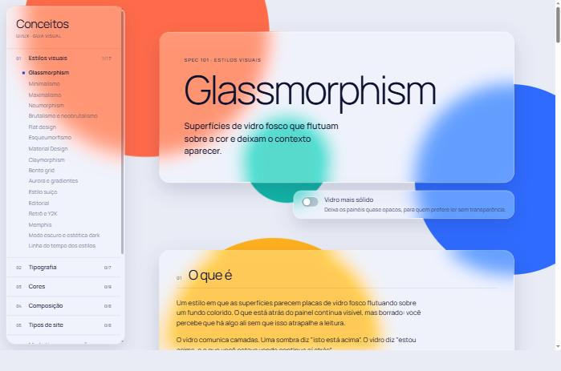
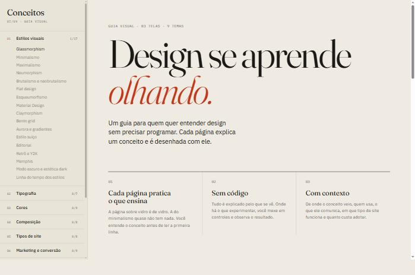

<div align="center">

# Conceitos UI/UX

**Design se aprende olhando.**

Um guia visual de web design em que cada página explica um conceito<br>
e é desenhada com ele.


**[🌐 Ver o guia online: conceitos-ui-ux.vercel.app](https://conceitos-ui-ux.vercel.app/)**

<br>

<a href="https://conceitos-ui-ux.vercel.app/"></a>

</div>

<br>

## Sobre o projeto

Estou desenvolvendo este projeto para estudar web design: estilos visuais, tipografia, cores, composição, tipos de site e um pouco de marketing. Em vez de anotar o que aprendo, construo. Cada conceito vira uma página, e a página é feita no próprio conceito.

A página sobre vidro fosco é feita de vidro fosco. A do minimalismo quase não vai ter nada. A de tipografia vai explicar cada fonte escrita nela mesma.

O guia é para quem quer entender design **sem precisar programar**: quem está começando na área, quem trabalha com marketing, quem vai encomendar um site e quer saber o que pedir.

## O que toda página responde

| | |
|---|---|
| **O que é** | O conceito em poucas frases, e de onde ele veio. |
| **O que não é** | As confusões mais comuns, lado a lado. |
| **Anatomia** | As peças visuais que produzem o efeito, uma por vez. |
| **Laboratório** | Controles para mexer e ver o resultado mudar. |
| **O que comunica** | A sensação que passa e o tipo de marca com que combina. |
| **Onde aplicar** | O veredito para loja, landing page, dashboard, app, blog e portfólio. |
| **Quanto custa** | Velocidade, leitura, produção e durabilidade. |
| **No mundo real** | Empresas que usam, e a história de como chegaram lá. |

Nenhuma página mostra código. Tudo é explicado pelo que se vê.

## Andamento

O guia está em construção. São 83 telas planejadas em 9 temas, e eu escolho a próxima pela vontade de aprender, não por ordem.

| Tema | Telas | Prontas |
|---|:-:|:-:|
| Estilos visuais | 17 | 1 |
| Tipografia | 7 | 0 |
| Cores | 9 | 0 |
| Composição | 8 | 0 |
| Tipos de site | 8 | 0 |
| Marketing e conversão | 9 | 0 |
| Padrões de interface | 10 | 0 |
| Movimento | 7 | 0 |
| Experiência do usuário | 8 | 0 |

**Pronta:** Glassmorphism.

O mapa completo, com uma linha para cada tela, está em [docs/specs/ROADMAP.md](docs/specs/ROADMAP.md).

<div align="center">
<br>

<br>
<sub>O menu é o mesmo em todas as páginas, mas troca de aparência conforme a página aberta.</sub>
</div>

## Como é construído

Cada tela passa pelas mesmas etapas antes de entrar aqui:

1. **Pesquisa.** O que mudou, quem usa hoje, o que as fontes dizem. Nada é citado de memória.
2. **Especificação.** Um documento por tela, em [docs/specs](docs/specs), com o conteúdo, a direção visual e os critérios para considerar a tela pronta.
3. **Aula.** Antes de construir, eu estudo o conceito.
4. **Protótipo.** Primeiro a aparência e uma seção; só depois de aprovar a direção, o resto.
5. **Tela completa**, testada em computador e celular.

Desenvolvo com o apoio do [Claude Code](https://claude.com/claude-code). As regras que ele segue neste projeto estão em [CLAUDE.md](CLAUDE.md).

## Por dentro

- **React e Vite, e mais nada.** Sem biblioteca de componentes, sem framework de CSS, sem roteador de terceiros. Um guia sobre estilos diferentes não pode depender de uma ferramenta que imponha um estilo só.
- **Uma pasta por tela**, em `src/concepts/<tema>/<tela>/`. Nenhuma tela depende de outra.
- **O menu troca de pele sozinho.** Ele usa apenas variáveis de aparência, e cada tela define as suas em um arquivo `theme.css`.
- **Uma tela existe quando a pasta dela existe.** O projeto descobre as telas prontas sem lista para manter.

Os detalhes estão em [docs/ARQUITETURA.md](docs/ARQUITETURA.md).

## Rodar na sua máquina

Requer Node 20.19+ ou 22.12+.

```bash
git clone https://github.com/FelipeMendes-git/conceitos-ui-ux.git
cd conceitos-ui-ux
npm install
npm run dev
```

Abra o endereço que aparecer no terminal, normalmente `http://localhost:5173`.

---

<div align="center">
<sub>Feito por <a href="https://github.com/FelipeMendes-git">Felipe Mendes</a>, uma tela de cada vez.</sub>
</div>
